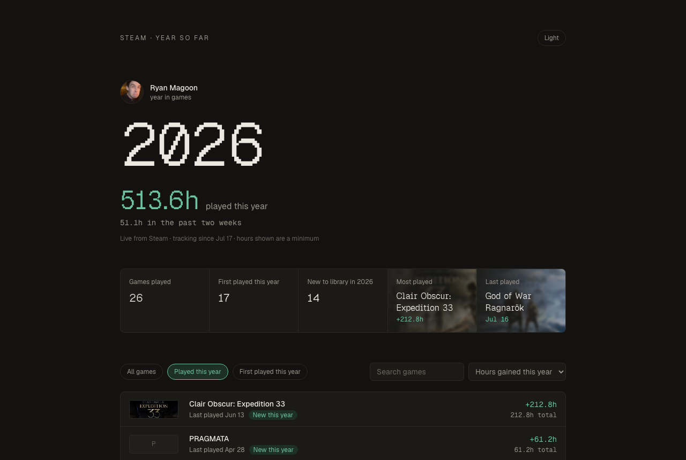

# yearsofar

Steam Replay only covers last year. This shows the current one.

[yearsofar.vercel.app](https://yearsofar.vercel.app)

## Run your own

Deploy to Vercel with the Neon integration, fill in the vars from
`.env.example`, and the daily cron handles the rest.
